### Description

XTDrone is a general-purpose UAV simulation platform based on PX4, ROS and Gazebo. It supports multirotor aircraft
(including quadrotors and hexarotors), fixed-wing aircraft, VTOL aircraft (quadplanes, tailsitters and tiltrotors),
and other unmanned systems such as ground vehicles, surface vessels and robotic arms. Algorithms validated in
XTDrone can be conveniently deployed on real UAVs.

This repository is XTDrone on **Ubuntu 24.04, ROS 2 Jazzy, Gazebo Harmonic and PX4 v1.16.2** (the only supported
stack on the `master` branch; the **`Ardupilot` branch** flies the vehicles with ArduPilot 4.7.2 instead, see
[ArduPilot branch](docs/manual/docs/getting-started/03a-ardupilot.md)). It keeps the vehicles, worlds, topics and chapters of the original XTDrone, ported to ROS 2.

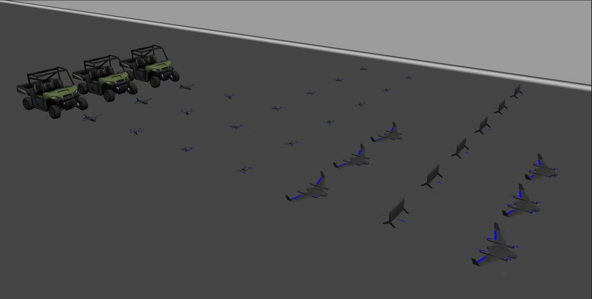

### Quick start

```bash
git clone --recursive https://github.com/parvu/XTDRONE-ROS2.git ~/XTDRONE-ROS2
cd ~/XTDRONE-ROS2
./scripts/setup_ubuntu_24_04.sh        # once: ROS 2 Jazzy, Gazebo Harmonic, MAVROS 2, PX4 dependencies
./scripts/build_xtdrone_ros2.sh        # PX4, the XTDrone worlds and models, the colcon workspace
source scripts/xtdrone_env.sh          # in every terminal
ros2 launch xtdrone_bringup xtdrone.launch.py scenario:=indoor1 communication:=basic
```

In a second terminal, `ros2 run xtdrone_py multirotor_keyboard_control iris 1 vel` flies the iris (`i` to raise
the upward speed above 0.3 m/s, `b` for offboard, `t` to arm).

### User manual

The manual (48 chapters, setup, build, every application) is in [docs/manual](./docs/manual/docs/index.md);
`./scripts/build_manual.sh` builds it locally. The [chapter status](./docs/manual/docs/reference/status.md) lists
what is ported and how it is tested (`scripts/tests/run_chapter_tests.sh`).

### Repository layout

| Path | Content |
|---|---|
| `ros2/` | the ROS 2 packages (`xtdrone_bringup`, `xtdrone_gz`, `xtdrone_py`, …) and third-party ROS 2 submodules |
| `PX4-Autopilot/` | PX4 v1.16.2 (submodule) |
| `scripts/` | setup, build, environment and test scripts |
| `docker/` | Docker image of the whole stack |
| `docs/manual/` | the user manual (MkDocs) |

### What XTDrone does

XTDrone helps developers quickly validate algorithms and applications, including:

**Stereo SLAM**

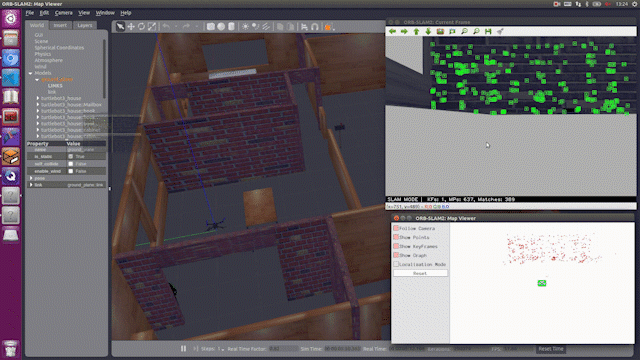

**Visual-inertial navigation**

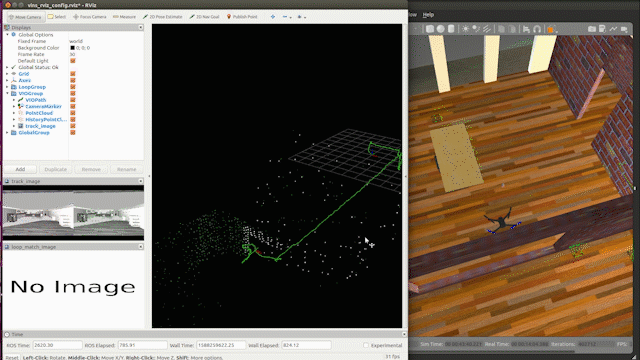

**Dense visual reconstruction**

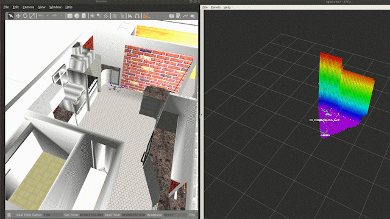

**2D laser SLAM**

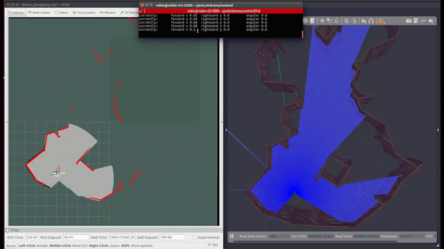

**3D laser SLAM**

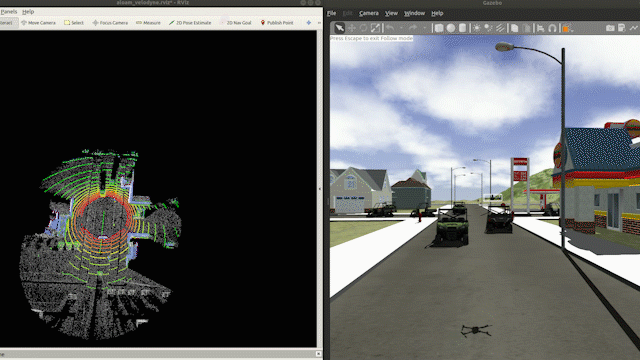

**2D motion planning**

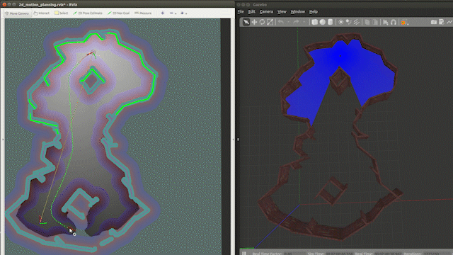

**3D motion planning**

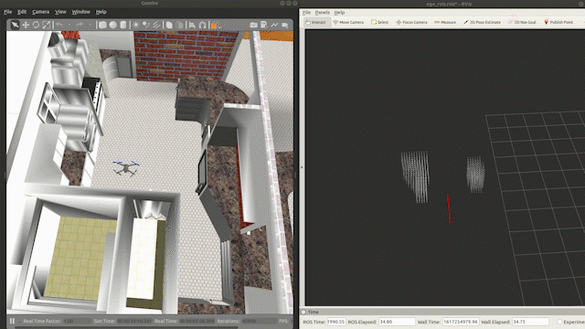

**Swarm motion planning**

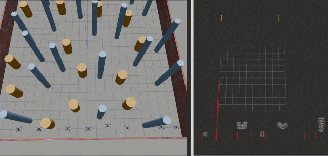

**Object detection and tracking**

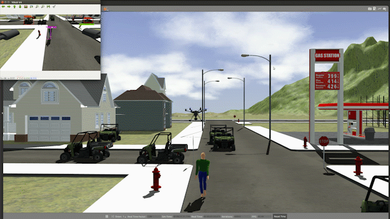

**Multi-UAV formation**

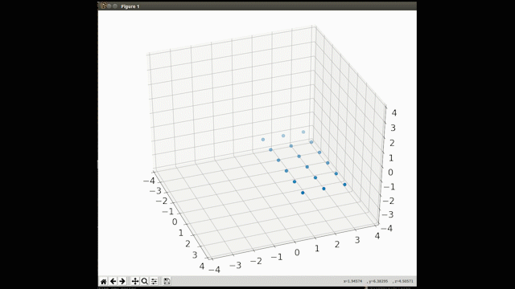
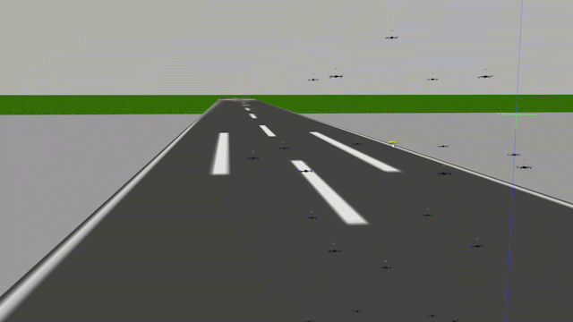

**Multi-UAV precision landing**

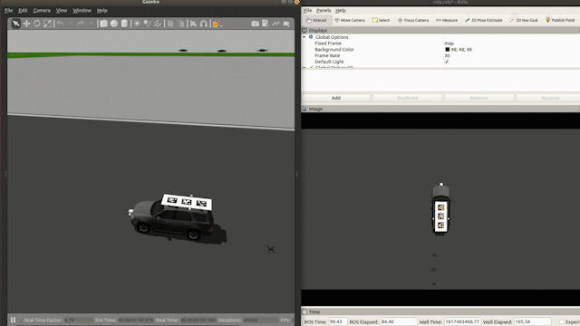

**Fixed-wing aircraft**

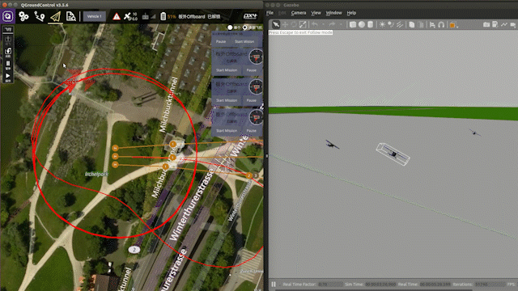

**VTOL aircraft**

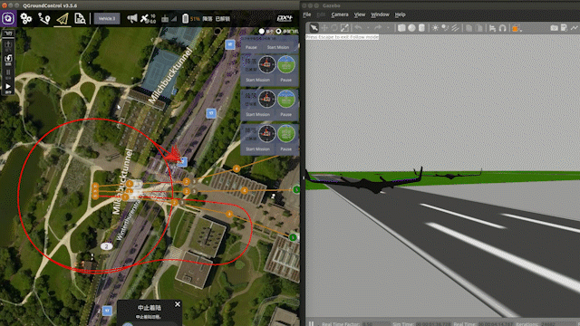

**Ground vehicles**

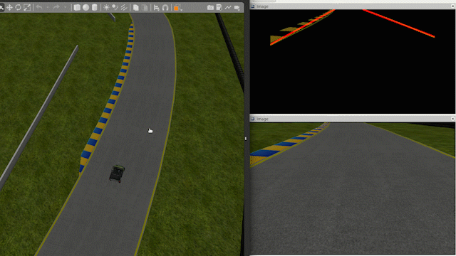
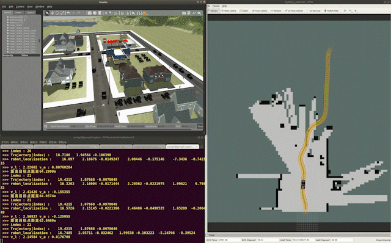

**Surface vessels**

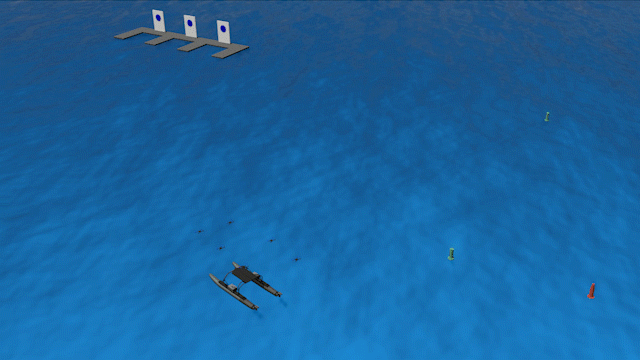

**Aerial manipulators**

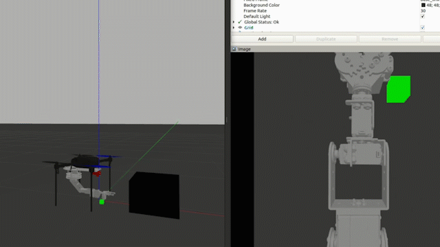

(The animations were recorded with the original XTDrone.)

### Citing XTDrone

If you use XTDrone to validate your research, please cite one of these papers:

K. Xiao, S. Tan, G. Wang, X. An, X. Wang and X. Wang, "XTDrone: A Customizable Multi-rotor UAVs Simulation
Platform," 2020 4th International Conference on Robotics and Automation Sciences (ICRAS), 2020, pp. 55-61,
doi: 10.1109/ICRAS49812.2020.9134922. Preprint: [arXiv:2003.09700](https://arxiv.org/abs/2003.09700)

K. Xiao, L. Ma, S. Tan, Y. Cong, X. Wang, "Implementation of UAV Coordination Based on a Hierarchical Multi-UAV
Simulation Platform," Advances in Guidance, Navigation and Control. Lecture Notes in Electrical Engineering, 2022,
vol. 644. Springer, Singapore. doi: 10.1007/978-981-15-8155-7_423. Preprint:
[arXiv:2005.01125](https://arxiv.org/abs/2005.01125)

### XTDrone project team

- Founders: Kun Xiao and Shaochang Tan
- Adviser: Xiangke Wang
- Developers: Kun Xiao, Shaochang Tan, An Zhuo, Guanzheng Wang, Lan Ma, Yuke Li, Qipeng Wang, Xinyu Hu, Xinning Wu, Jiayi Zheng, Yufan Peng, Zijun Zheng, Jiarun Yan, Feng Yi, Ruoqiao Guan, Wenxin Hu, Yi Bao, Xudong Liu, Jie Min, Chuanlu Liu, Ciyu Ruan, and Dehao Kong.
- Port for Ubuntu 24.04: Claude, Copilot and Valentin Parvu.

### Contributors

We sincerely thank all XTDrone contributors: Keyan Chen, Jiangwei Xu, Yongguang Lu, Gao Chen, Changhao Sun,
Ying Nie, Fanjie Kong, Chaoran Li, Xudong Li, Huaqing Zhang, Zihan Lin, and Yao He.
